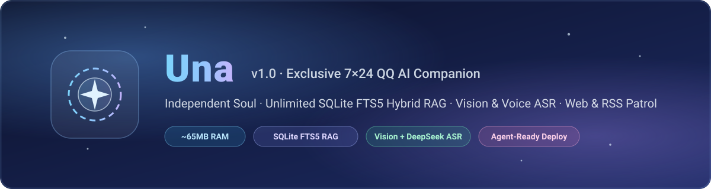
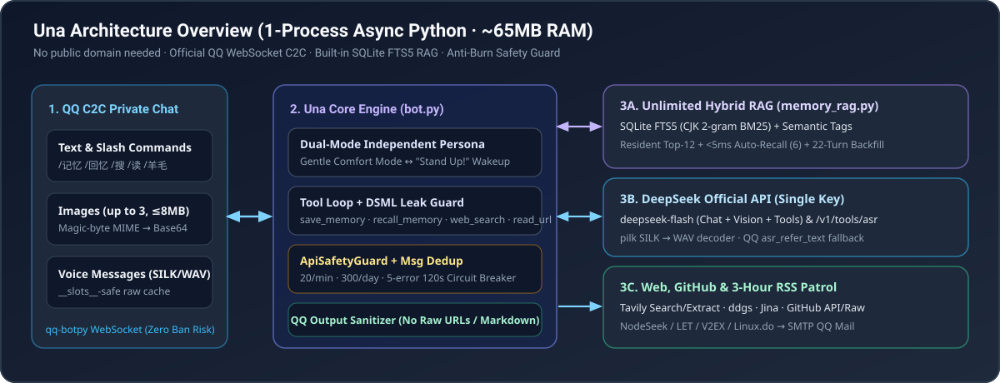
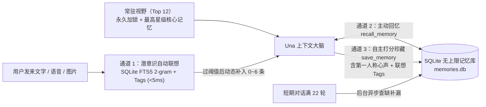
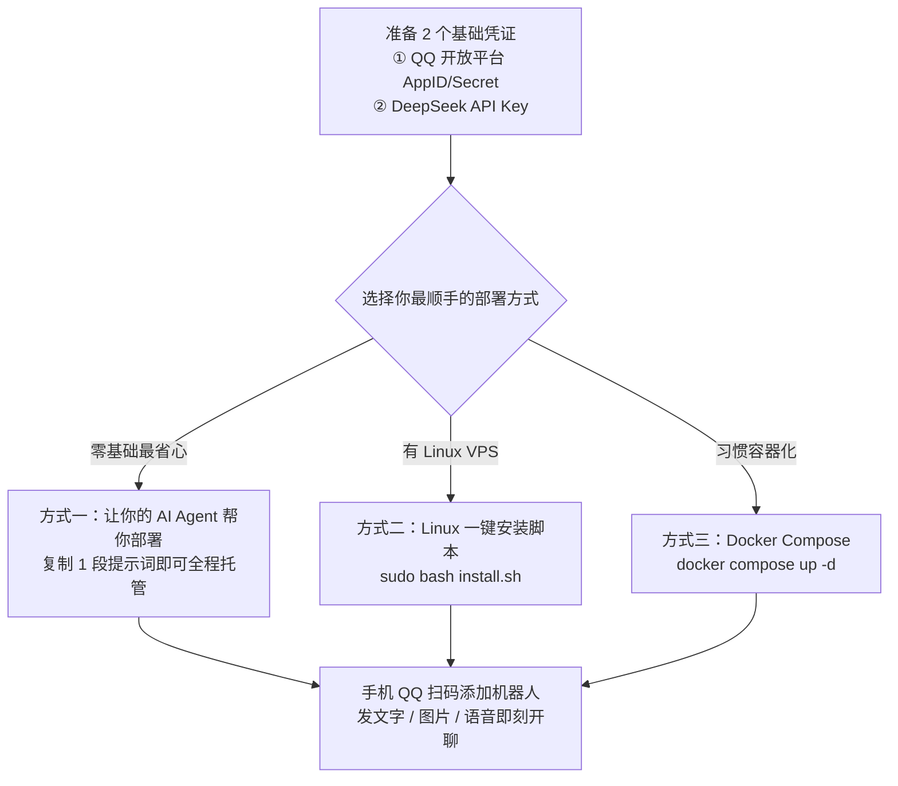

<p align="center">
  
</p>

<p align="center">
  <a href="https://github.com/PHOENIX-collab-bot/Una/actions/workflows/ci.yml"></a>
  <a href="https://github.com/PHOENIX-collab-bot/Una/releases"></a>
  <a href="https://github.com/PHOENIX-collab-bot/Una/pkgs/container/una"></a>
  
  
  <a href="./LICENSE"></a>
</p>

<p align="center">
  <strong>专为 2 核 1G 低配 Linux VPS 打造的 7×24 QQ 官方专属私聊 AI 伴侣</strong><br/>
  独立意识双模式人格 · 零依赖 SQLite FTS5 混合 RAG 长期记忆 · 看图 + 听语音 · 联网与 GitHub 精读 · 羊毛巡逻
</p>

<p align="center">
  <a href="#快速部署小白-5-分钟上手">快速部署</a> ·
  <a href="./docs/AGENT_DEPLOY.md">AI Agent 托管部署</a> ·
  <a href="./docs/ARCHITECTURE.md">技术架构</a> ·
  <a href="./docs/DEPLOYMENT.md">完整运维手册</a> ·
  <a href="./CHANGELOG.md">更新日志</a>
</p>

---

## 为什么选择 Una？

- **官方合规、零门槛运行**：基于腾讯官方 `qq-botpy` WebSocket 长连接，**免域名、免备案、免公网回调端口、零个人 QQ 封号风险**；仅响应专属私聊（C2C）。
- **极致轻量（~65MB 内存）**：不引入 Chroma/Milvus 或重型本地模型，靠 Python 内置 **SQLite FTS5** 实现无上限个人记忆 RAG，一台最便宜的 **2 核 1G VPS** 就能 7×24 丝滑常驻。
- **真正有“活人感”的伴侣灵魂**：具备独立的情绪、小倔强、主见与第一人称心声，可在「温柔包裹模式」与「“站起来”唤醒模式」间动态切换，彻底剔除客服腔与生硬 Markdown。
- **全模态交互 & 单一 Key 省心接入**：默认使用官方 `deepseek-flash` 同时处理聊天、工具调用与**多模态看图**，并复用同一个 `LLM_API_KEY` 直连 DeepSeek 官方 `/v1/tools/asr` 实现**听懂 QQ 语音**。
- **自带生产级防空转熔断**：内置 `msg_id` 重放去重、每分钟/每日频控与连续 5 次报错自动熔断 120 秒，避免网络抖动或异常空转烧光余额。

---

## 系统架构一览

<p align="center">
  
</p>

### 长期记忆混合 RAG 工作流（零新增依赖）



> 更多关于多模态视觉、QQ 语音解析（`__slots__` 兼容 + SILK 解码）与熔断机制的原理图，请查看 [**技术架构深度文档**](./docs/ARCHITECTURE.md)。

---

## 快速部署（小白 5 分钟上手）



### 方式一：结合你自己的 AI Agent 一键托管部署（最推荐给小白）

本仓库内置了标准 [`AGENTS.md`](./AGENTS.md) 与 [`docs/AGENT_DEPLOY.md`](./docs/AGENT_DEPLOY.md)。无论你使用的是 **Antigravity、Cursor、Claude Code、Codex 还是 Windsurf**，只需要：

1. 将本仓库克隆到本地，用你的 AI Agent 打开项目目录；
2. 直接把下面这段提示词复制发给你的 Agent：

```text
请先阅读本仓库的 AGENTS.md 和 docs/AGENT_DEPLOY.md。
我是部署新手，请你一步步带我完成 Una QQ 机器人的配置和部署：
1. 先告诉我需要提前去哪些官网申请哪些凭证（分清必填和选填）；
2. 帮我根据我的昵称和偏好生成本地 .env 配置（注意不要提交到 Git）；
3. 根据我的运行环境（Linux VPS 或 Docker）给出最简单的一键启动命令并帮我核对上线日志。
```

> 想要定制专属角色名、性格口癖或远程 SSH 托管提示词？详见 [**AI Agent 托管部署指南**](./docs/AGENT_DEPLOY.md)。

---

### 方式二：Linux VPS（Debian / Ubuntu）一键脚本部署

只需一台能联网的 Linux 服务器（1G 内存即可，`install.sh` 会自动安全检测并按需配置 2G Swap、独立虚拟环境、`pilk` 语音解码与 `systemd` 7×24 开机自启）：

```bash
git clone https://github.com/PHOENIX-collab-bot/Una.git
cd Una
sudo bash install.sh
```

按脚本末尾提示填入配置并启动：

```bash
nano /opt/studybot/.env          # 填入 QQ_APPID、QQ_SECRET、LLM_API_KEY、USER_NICKNAME
systemctl restart studybot       # 启动服务
journalctl -u studybot -n 30 -f  # 查看实时上线日志
```

---

### 方式三：Docker Compose / GitHub Packages 部署

镜像会自动发布至 GitHub Container Registry（`ghcr.io/phoenix-collab-bot/una:latest`）：

```bash
git clone https://github.com/PHOENIX-collab-bot/Una.git
cd Una
cp .env.example .env
nano .env                        # 填入必填凭证
docker compose up -d             # 后台一键启动
docker compose logs -f una       # 查看运行日志
```

---

## 核心功能与 QQ 私聊指令

| 指令 | 别名 | 说明 |
| :--- | :--- | :--- |
| **直接发文字 / 语音 / 图片** | 无 | 伴侣聊天、听语音（DeepSeek ASR + QQ 兜底）、看图片（最多 3 张）；重要话语自动珍藏，旧话题自动联想，问资讯自动搜索，发链接自动精读 |
| `/记忆` | `/日记`、`/memory` | 查看永久珍藏总条数、常驻核心记忆（带 `#编号`、星级、`[永存]` 与心声）及近期新增条目 |
| `/回忆 关键词` | `/查记忆`、`/recall` | 按关键词检索整个 SQLite 长期记忆库 |
| `/记住 内容` | `/remember` | 将重要小事以永久加锁状态（`[永存]`）直接写入记忆库 |
| `/锁死 编号` | `/置顶`、`/pin` | 锁定或解锁某条记忆使其永久常驻对话视野（如 `/锁死 3`） |
| `/忘掉 编号` | `/删记忆`、`/forget` | 精准删除记错或过时的某条记忆（如 `/忘掉 8`） |
| `/搜 问题` | `/search` | 强制联网检索实时资料（Tavily 优先，`ddgs` 兜底） |
| `/读 网址` | `/read` | 精读网页正文或 GitHub 开源仓库（元数据 + `README` + 1G 部署评估） |
| `/羊毛` | `/deals` | 总结最近巡逻抓到的 AI / Token / 黑五 / VPS 优惠线索 |
| `/刷新` | `/refresh` | 立即全网巡逻一轮 RSS，有新线索时推送带直达链接的邮件简报 |
| `/清空` | `/clear` | 清空短期对话上下文（SQLite 长期记忆库**不会**被清空） |
| `/help` | `/帮助` | 查看所有可用指令 |

---

## 环境变量速查（`.env`）

| 变量名 | 必填 | 默认值 | 说明 |
| :--- | :---: | :--- | :--- |
| `QQ_APPID` / `QQ_SECRET` | ✅ | 无 | 腾讯 [QQ 开放平台](https://q.qq.com/) 机器人凭证（需开启 WebSocket + 单聊 C2C + 服务器 IP 白名单） |
| `LLM_API_KEY` | ✅ | 无 | OpenAI 兼容大模型 API Key（默认复用此 Key 调用 DeepSeek 官方 ASR 听语音） |
| `LLM_BASE_URL` | ❌ | `https://api.deepseek.com` | 大模型接口地址（也支持 Gemini 等 OpenAI 兼容接口） |
| `LLM_MODEL` | ❌ | `deepseek-flash` | 对话与多模态看图模型名称 |
| `BOT_NAME` / `USER_NICKNAME` | ❌ | `Una` / `你` | 机器人自称与对你的专属称呼 |
| `EXTRA_PERSONA` | ❌ | 空 | 可选补充性格、口癖或专属设定 |
| `TAVILY_API_KEY` | ❌ | 空 | 推荐填写（免费 1,000 次/月），同时驱动联网搜索与网页正文提取 |
| `RSS_FEEDS` / `CHECK_INTERVAL_MIN` | ❌ | 内置 4 源 / `180` | 羊毛巡逻 RSS 列表与巡逻间隔（分钟） |
| `SMTP_USER` / `SMTP_PASS` | ❌ | 空 | QQ 邮箱与 16 位授权码，用于接收带原始直达链接的羊毛快报 |
| `API_MAX_CALLS_PER_MIN` / `DAY` | ❌ | `20` / `300` | 防空转烧 Token 的安全调用上限 |

---

## 项目目录结构

```text
Una/
├── bot.py                        # 主程序（独立意识人格、看图、听语音、搜索/精读、RSS 巡逻、安全熔断）
├── memory_rag.py                 # 零依赖 SQLite FTS5 中文 2-gram 混合 RAG 长期记忆引擎
├── install.sh                    # Debian / Ubuntu 一键安装与升级脚本
├── Dockerfile & docker-compose.yml # 容器化部署与 GitHub Packages 镜像配置
├── pyproject.toml                # PEP 621 标准 Python 打包配置（支持 pip install 与 una-bot 命令）
├── AGENTS.md                     # AI Agent 协作规范（供 Cursor / Antigravity / Claude Code 等读取）
├── tests/test_una.py             # 离线单元测试套件（GitHub Actions CI 自动验证）
└── docs/
    ├── AGENT_DEPLOY.md           # 小白专属：AI Agent 托管部署与个性化定制指南
    ├── ARCHITECTURE.md           # 系统架构、RAG 算法与安全熔断深度解析
    ├── DEPLOYMENT.md             # 完整凭证申请、三种部署方式与运维排错手册
    └── assets/                   # Banner 与架构示意图
```

---

## 本地测试与参与贡献

```bash
# 运行全部离线单元测试（无需任何真实 API Key）
python -m unittest discover -s tests -v
```

- 详细部署与排错指南请见 [**docs/DEPLOYMENT.md**](./docs/DEPLOYMENT.md)
- 欢迎通过 Issue / PR 参与贡献，请先阅读 [**CONTRIBUTING.md**](./CONTRIBUTING.md)
- **安全提醒**：切勿将真实 `.env`、`AppSecret`、API Key、邮箱授权码或 `data/memories.db` 上传至公开仓库。

## License

本项目基于 [MIT License](./LICENSE) 开源。
