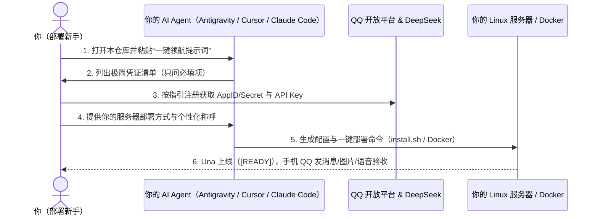

# 小白专属：结合你自己的 AI Agent 一键部署 Una

如果你对 Linux 命令行、SSH 或服务器运维不太熟悉，**最省心的办法就是把本仓库直接交给你的 AI Agent**（如 **Antigravity、Cursor、Claude Code、OpenAI Codex、Windsurf** 等）。

本仓库根目录内置了 [`AGENTS.md`](../AGENTS.md)，任何支持读仓库的 AI Agent 打开后都会立刻理解 Una 的架构、安全规范和部署流程，像私人运维工程师一样手把手带你跑通。

---

## 整体协作流程示意图



---

## 第一步：打开项目

任选一种方式把仓库放到本地文件夹并用你的 AI Agent 打开：

```bash
git clone https://github.com/PHOENIX-collab-bot/Una.git
```

*(如果连 Git 都没装，也可以直接在 GitHub 页面点击 **Code → Download ZIP** 解压后，用你的 AI Agent 打开解压出来的文件夹。)*

---

## 第二步：复制下面任意一段提示词发给你的 Agent

### 场景 A：零基础手把手领航部署（最推荐）

直接整段复制发送给你的 Agent：

```text
请先阅读本仓库的 AGENTS.md 和 docs/DEPLOYMENT.md。
我是零基础新手，想部署一个属于我自己的 7×24 在线 Una QQ 伴侣机器人。
请按以下方式带我一步步完成（每次只让我做 1~2 件事，不要一次丢一堆命令）：
1. 先告诉我需要去哪些官网申请哪些凭证，分清【必填】和【可选】；
2. 问我部署环境（比如海外 Linux VPS、本地电脑 Docker 等）以及我希望 Una 怎么称呼我；
3. 帮我生成安全的配置操作命令（提醒我不要把真实密钥提交到 Git），并用最简单的方式（install.sh 或 docker compose）部署上线；
4. 最后教我怎么看日志和发 3 条测试消息（文字、图片、语音）确认全部功能正常。
```

---

### 场景 B：你已经有 Linux VPS 且想快速全自动升级/托管

```text
请阅读本仓库的 AGENTS.md。我有一台 Debian/Ubuntu 服务器，准备用 install.sh（或 Docker Compose）部署 Una。
请帮我：
1. 检查当前仓库代码并跑一遍 `python -m unittest discover -s tests -v` 确认本地无误；
2. 生成一条在服务器上从拉取仓库、执行 install.sh 到配置 .env 的完整引导步骤；
3. 告诉我如何在 QQ 开放平台配置 IP 白名单和单聊（C2C）WebSocket 事件订阅；
4. 部署完帮我核对 `journalctl -u studybot` 日志中的 [READY]、[VISION]、[VOICE:DeepSeekASR] 和 [CORE MEMORY] 标志。
```

---

### 场景 C：想把 Una 改造成你专属的角色人设

在部署前或部署后，可以直接让你的 Agent 帮你微调人设：

```text
请阅读 bot.py 中的 build_companion_system_prompt 和 .env.example。
我想把机器人的名字改成「____」，希望她称呼我为「____」，性格偏「____（例如：温柔治愈 / 毒舌傲娇 / 冷静理性学习搭子）」。
请在不破坏原有记忆工具（save_memory / recall_memory）、DSML 防泄漏保护和 QQ 无链接输出规则的前提下，帮我修改配置或提示词，修改完跑一遍 tests/test_una.py 确认全部通过。
```

---

## 给新手的 3 条安全提醒

1. **绝不泄露真实密钥到公开仓库**：你的 `QQ_SECRET`、`LLM_API_KEY`、`TAVILY_API_KEY`、`SMTP_PASS` 只应该填在服务器或本地被 `.gitignore` 忽略的 `.env` 文件里，不要让 Agent 把它们写进 `bot.py` 或公开提交。
2. **公网 IP 白名单别忘填**：如果 QQ 发消息没反应，90% 是因为 QQ 开放平台「开发管理 → IP 白名单」里漏填了服务器公网 IP。
3. **默认自带防烧钱保护**：Una 内置了 `ApiSafetyGuard`（每分钟 20 次 / 每日 300 次上限 + 连续 5 次报错自动熔断 120 秒），新手放心折腾也不会因为配置失误把余额瞬间烧光。
