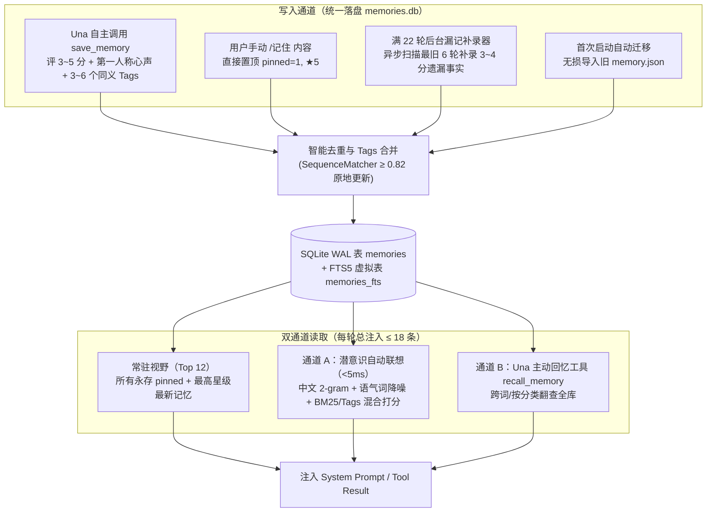
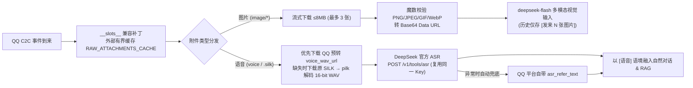
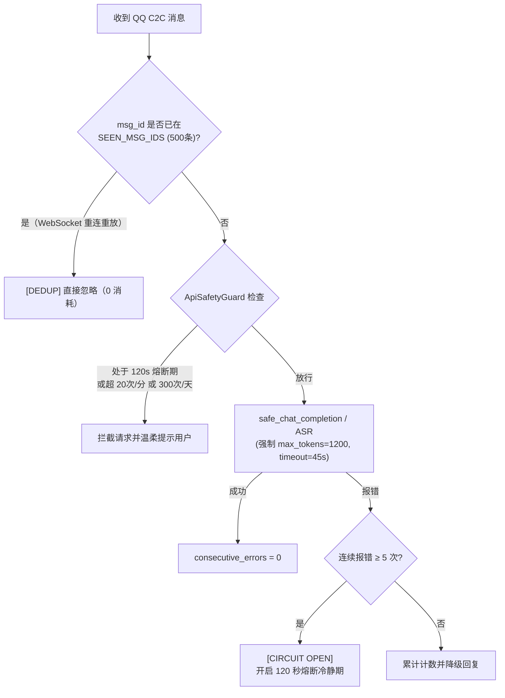

# Una 技术架构与核心机制解析

本文档面向开发者与希望深度定制 Una 的用户，详细说明记忆 RAG、多模态视觉/语音流水线与防空转熔断的设计原理。

---

## 1. 零依赖混合 RAG 长期记忆引擎（`memory_rag.py`）

为了在 **2 核 1G 内存 VPS** 上实现“聊几年都不丢记忆，同时单次对话上下文不膨胀”，Una 将“硬盘存储容量”与“单轮对话读取窗口”彻底解耦：

### 关键工程细节
- **为什么不用本地 Embedding / 向量库？** 本地运行 `bge-m3` 等模型会占用 600MB~1.5GB 内存，在 1G VPS 上极易 OOM；而 Python 标准库内置的 `sqlite3`（FTS5）内存增量 < 5MB，查询耗时 < 5ms。
- **如何解决 SQLite 原生不懂中文分词 + 同义词联想？**
  1. **轻量中文 2-gram / 3-gram 分词 + 语气助词切分**：自动按 `的了吗呢吧啊呀哦嘛哇` 切分，避免产生无效碎片词元，同时剔除 90+ 中文口语虚词及双方称呼。
  2. **AI 自主生成同义触发词 `tags`**：Una 存记忆时顺手写 3~6 个关联场景词（如记“年底去北海道看雪”附带 `["旅行","日本","滑雪","度假"]`），FTS5 为 `tags_tok` 赋予 **2.2× 权重**，实现跨词语义联想。
  3. **防误触门槛（`strict_gate`）**：普通问候（如“早安”“哈哈”）直接返回 0 条，避免无关旧事强行插入导致出戏。
- **句柄安全**：所有数据库连接通过 `@contextlib.contextmanager` 在事务完成后立即 `close()`，杜绝长时间运行下的文件描述符泄漏。

---

## 2. 多模态输入管道（看图片 + 听语音）

### 关键避坑点
- **`qq-botpy` `__slots__` 兼容**：腾讯官方 SDK 的 `C2CMessage` 使用 `__slots__`，直接给实例赋值新属性会抛出 `AttributeError`。Una 通过模块级有界 `OrderedDict`（上限 100 条，并在 `finally` 中按 `msg_id` 即时清理）安全提取原始 JSON 中的 `voice_wav_url` 与 `asr_refer_text`。
- **DeepSeek DSML 防泄漏**：多轮工具调用时（最多 2 轮工具 + 1 轮最终收口），每轮均持续传入 `tools=BOT_TOOLS`；若模型仍偶发输出 `<｜DSML｜ calls>` 标签，`[DSML GUARD]` 会自动清洗并切换无工具纯文本通道重新汇总。

---

## 3. 防空转烧 Token 安全阀（`ApiSafetyGuard`）

